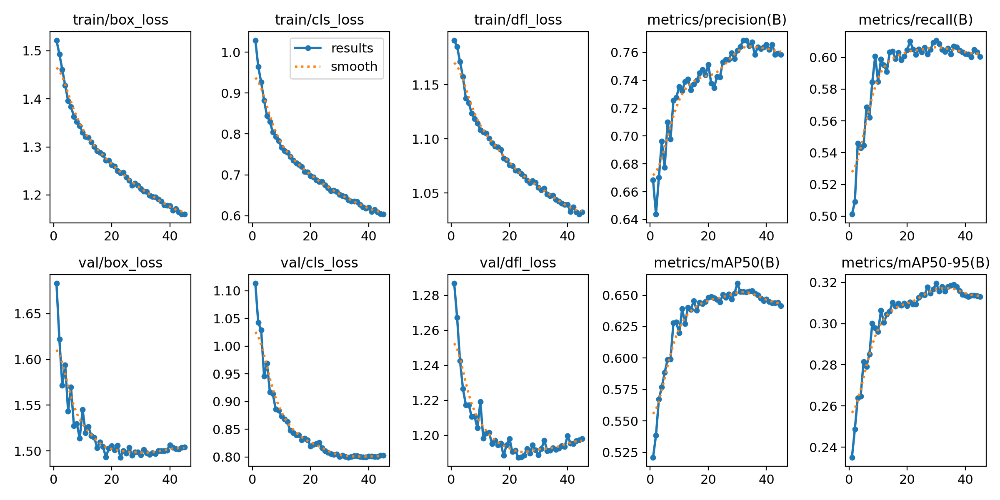
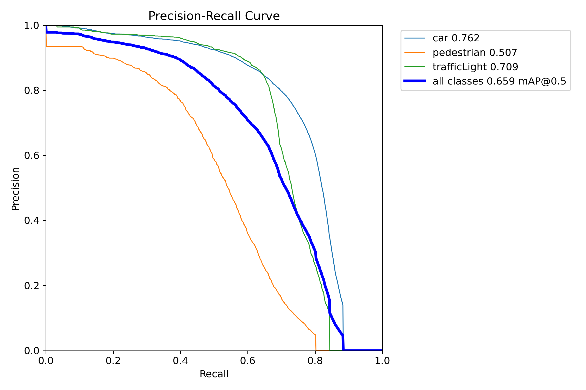
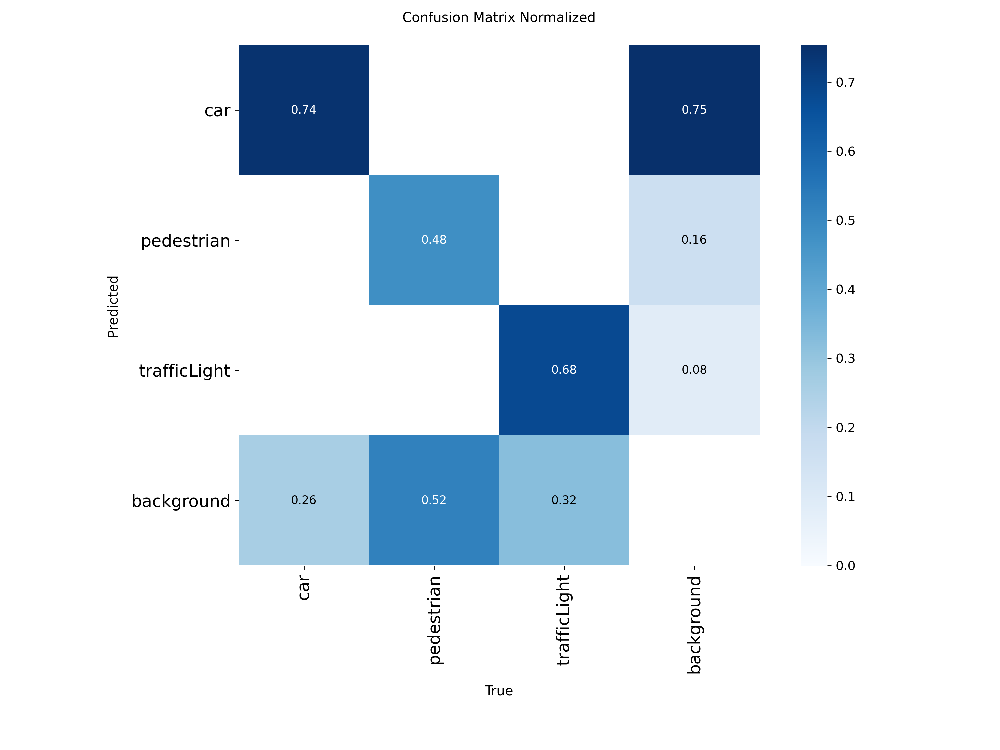

# Road Scene Object Detection with YOLO11m

**Computer Vision academic project** · Python · Ultralytics YOLO11 · Object Detection

Fine-tuned YOLO11m to detect **cars, pedestrians, and traffic lights** in road scenes. This portfolio repository shares the experiment's recorded validation metrics, training configuration, charts, and inference utility.

> **Scope and reproducibility:** This is an academic object-detection experiment, not a self-driving system. The original training notebook, preprocessing code, and processed dataset are no longer available. This *web-upload edition* does **not** distribute the 39 MB trained checkpoint or the original demo videos / report. The saved metrics are historical validation results, not a new evaluation.

## Recorded validation results

The best recorded validation epoch by **mAP@0.50:0.95** is **epoch 30**, according to [`results/results.csv`](results/results.csv).

| Validation metric | Recorded value |
|:--|--:|
| Precision | **76.15%** |
| Recall | **61.08%** |
| mAP@0.50 | **65.95%** |
| mAP@0.50:0.95 | **31.95%** |

The saved training log contains **45 epochs** (configured maximum: 100; early-stopping patience: 15). The model performs less strongly on **pedestrian** detection than on the other recorded classes.



| Precision–recall curve | Normalized confusion matrix |
|:--:|:--:|
|  |  |

## Experiment configuration

The archived [`results/args_original.yaml`](results/args_original.yaml) records:

| Parameter | Recorded value |
|:--|:--|
| Model | Pretrained `yolo11m.pt` |
| Image size | 800 |
| Batch size | 16 |
| Optimizer | AdamW |
| Initial learning rate | 0.001 |
| LR schedule | Cosine enabled |
| Augmentation | Mosaic, MixUp, horizontal flip (and others in YAML) |
| Max epochs / patience | 100 / 15 |

**Note:** The archived YAML includes Kaggle-specific local paths. It is not a ready-to-run training pipeline.

## View the archived metrics

No dataset or GPU is needed for this command:

```bash
python scripts/summarize_metrics.py
```

## Run inference (with your own authorized checkpoint)

The trained `best.pt` is **not included in this web-upload edition** because GitHub browser uploads have a 25 MiB per-file limit, and redistribution terms should be checked before public sharing. If you have the original checkpoint and permission to use it, save it locally as `weights/best.pt`.

```bash
python -m pip install -r requirements.txt
python scripts/predict.py --weights weights/best.pt --source path/to/image_or_video.mp4
```

The script saves detected objects to `outputs/predictions/`. Without the local checkpoint, the inference command cannot run; the saved metrics and figures remain viewable.

## Repository structure

```text
├── docs/
│   ├── DATASET.md                  # Source and evaluation caveats
│   └── REPOSITORY_STATUS.md       # What is and is not preserved
├── results/                       # Archived plots, training CSV and arguments
├── scripts/
│   ├── predict.py                 # Inference utility; local weights required
│   └── summarize_metrics.py       # Read archived validation results
├── weights/README.md              # Checkpoint instructions (no weights shared)
├── requirements.txt
└── README.md
```

## Dataset, limitations, and credits

- **Dataset cited in the academic work:** [Self-Driving Cars (Kaggle)](https://www.kaggle.com/datasets/alincijov/self-driving-cars).
- The saved model's three classes are `car`, `pedestrian`, and `trafficLight`.
- The original preprocessing scripts, processed dataset and training notebook were not preserved. A fresh training run is **not** reproducible from this repository alone.
- These are **validation**, not independent test, metrics; they do not establish real-world driving reliability.
- Third-party source imagery, videos, reports, and checkpoint distribution require permission and are not provided in this public edition.

See [`docs/DATASET.md`](docs/DATASET.md) and [`docs/REPOSITORY_STATUS.md`](docs/REPOSITORY_STATUS.md).
